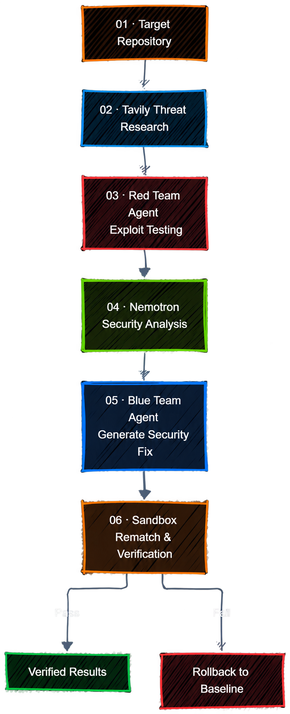

 <div align="center">

# ZeroDay: AI-Powered Vulnerability Remediation

### From Vulnerability Discovery to Verified Remediation.

**Find the flaw. Engineer the fix. Prove it with evidence.**

An AI-assisted security engineering platform combining code analysis, intelligent investigation, autonomous remediation, and evidence-oriented verification.

<br>

[](https://nebiusglobalaihackathon.devpost.com/)
<br>

[](https://www.python.org/)
[](https://fastapi.tiangolo.com/)
[](https://react.dev/)
[](https://vite.dev/)
[](https://developer.nvidia.com/)
[](https://nebius.com/)
[](https://tavily.com/)
[](LICENSE)<br>

**[Explore the Code](https://github.com/darshansahare/ZeroDay) · [How It Works](#how-it-works) · [Core Capabilities](#core-capabilities) · [Getting Started](#getting-started)**

</div>

---

## Security doesn't end when a vulnerability is found.

Finding a vulnerability is one thing. Understanding it, engineering a meaningful fix, and verifying the result is another.

**ZeroDay is built around that entire journey.**

It brings AI-assisted code analysis, intelligent investigation, remediation, and controlled verification into one security engineering workflow — helping developers move from a suspicious code path toward an actionable, evidence-backed result.

**The core idea:** Don't stop at finding the flaw. Work toward proving the fix.

## How It Works

<div align="center">

</div>

<br />

## Core Capabilities

- **Code-aware security analysis** — inspect code and identify potentially vulnerable paths.
- **AI-assisted investigation** — use an AI-driven workflow to help reason about findings.
- **Automated remediation** — generate candidate fixes for identified issues.
- **Controlled validation** — execute supported checks in a controlled environment.
- **Verification-first workflow** — evaluate remediation using verification gates and supporting evidence.
- **Developer-focused interface** — bring the security workflow into a unified web experience.


## Built for the Nebius × NVIDIA Global AI Hackathon

**Track:** Coding & Agentic Engineering

### The Problem

AI can help developers write code, but generating a patch is not the same as proving that it works. Security analysis, root-cause investigation, remediation, and verification are often disconnected steps. A proposed fix can pass basic tests while leaving the underlying vulnerability unresolved.

### Our Approach

**ZeroDay turns vulnerability discovery into a verification-oriented security workflow.**

Instead of stopping at a suspicious code path or an AI-generated patch, ZeroDay coordinates a sequence of specialized stages:

- **Target Repository:** Analyze the target codebase to identify potentially vulnerable code paths.
- **Tavily Threat Research:** Look up relevant security advisories and vulnerability guidance, with an offline fallback.
- **Red Team Agent:** Run exploit tests against the target application to check whether the suspected vulnerability is reproducible.
- **Nemotron Security Analysis:** Investigate the vulnerability's root cause and determine a suitable remediation approach using NVIDIA Nemotron via Nebius Token Factory.
- **Blue Team Agent:** Generate and apply a security fix targeting the identified vulnerability.
- **Sandbox Rematch & Verification:** Rerun tests and replay exploit attempts to check whether the fix works.
- **Verified Results (Pass):** Record the outcome when the required verification checks pass.
- **Rollback to Baseline (Fail):** Restore the saved baseline if verification fails.

## Core Technology

| Layer | Technology |
|---|---|
| Frontend | React, Vite, JavaScript |
| Backend | Python, FastAPI |
| AI model | NVIDIA Nemotron |
| Inference infrastructure | Nebius Token Factory |
| Execution and isolation | Docker-based workflows |
| Testing | Pytest |

## Getting Started

### Prerequisites

- Python
- Node.js and npm
- Docker Desktop, if required by the execution workflow
- A configured Nebius API key for live model inference

### 1. Clone the repository

```bash
git clone https://github.com/darshansahare/ZeroDay.git
cd ZeroDay
```

### 2. Configure environment variables

Create your local environment configuration using `.env.example` as the reference.

Add your own API credentials locally. **Never commit your `.env` file or private API keys.**

### 3. Install dependencies

Follow the backend and frontend dependency instructions in the repository. Exact commands may depend on the current project configuration.

### 4. Start ZeroDay

Use the run commands documented for the current backend and frontend setup. If using the production-served frontend, ensure the required frontend build assets are available.

## Roadmap

- Expand supported vulnerability patterns and code-analysis coverage.
- Improve remediation quality and verification reliability.
- Strengthen test coverage and reproducibility.
- Improve reporting and evidence presentation.
- Extend support for additional languages and project types.

## Contributing

Contributions, bug reports, and suggestions are welcome. Open an issue to discuss a proposed change before submitting a pull request.

## License

Released under the [MIT License](LICENSE).

## Author

**Darshan Sahare**

[GitHub](https://github.com/darshansahare)

